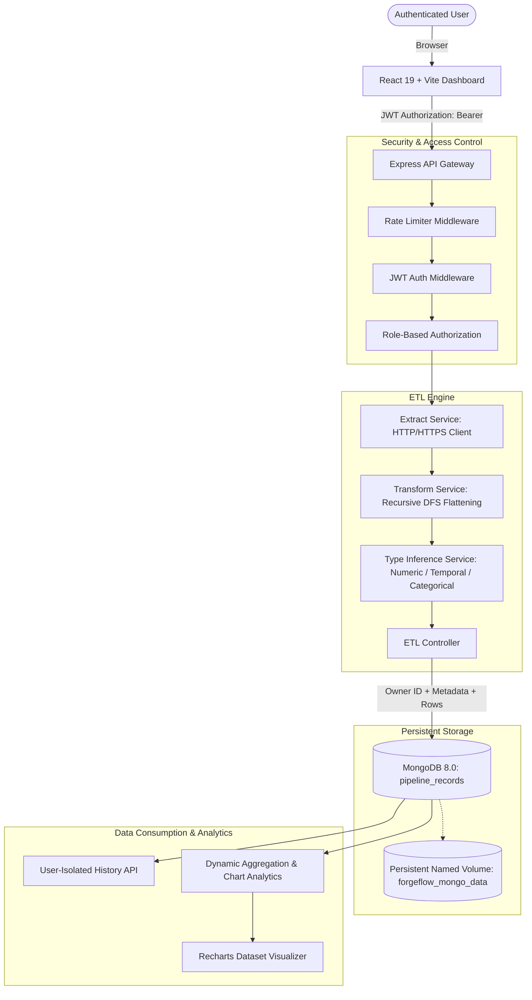

# ForgeFlow — Schema-Agnostic API-to-Analytics ETL Platform

ForgeFlow is a full-stack, multi-user ETL platform that connects to external JSON REST APIs, transforms nested and irregular JSON payloads into tabular records, infers field types, persists pipeline runs in MongoDB, and presents the resulting datasets through an interactive dashboard with dynamic analytics visualization.

The platform is containerized with Docker and Docker Compose, enforces role-based access control (RBAC), and ensures strict per-user pipeline ownership and data isolation.

---

## Architecture



---

## Technology Stack

| Layer | Technologies |
|---|---|
| **Frontend** | React 19, Vite, Tailwind CSS, Motion, Lucide React |
| **Visualization** | Recharts (Bar, Line, Area, Scatter, Pie) |
| **Backend** | Node.js (v20 Alpine), Express.js |
| **Database** | MongoDB 8.0 (Pinned), Mongoose 8 |
| **Containerization** | Docker, Docker Compose, Multi-stage builds, Non-root execution |
| **Security & Auth** | JSON Web Tokens (JWT), bcrypt (cost 12), RBAC, Rate Limiting |
| **Testing** | Node.js built-in Test Runner (`node:test`, `node:assert`) |

---

## Repository Structure

```text
ForgeFlow/
├── docker-compose.yml       # Production multi-service container orchestration
├── .env.example             # Safe environment variable configuration template
├── README.md                # Project documentation and API reference
├── etl-backend/
│   ├── Dockerfile           # Multi-stage, non-root Node 20 Alpine container definition
│   ├── .dockerignore        # Excludes secrets, node_modules, and development artifacts
│   ├── package.json         # Backend manifest, test and seed scripts
│   ├── server.js            # Express bootstrap, CORS, pre-flight checks, graceful shutdown
│   ├── src/
│   │   ├── config/          # MongoDB connection pool and lifecycle handlers
│   │   ├── controllers/     # Authentication and ETL pipeline controllers
│   │   ├── middleware/      # JWT protection, role checks, and IP rate limiting
│   │   ├── models/          # User (RBAC) and PipelineRecord (Owner-isolated) schemas
│   │   ├── routes/          # Express route definitions (/api/auth, /api/etl)
│   │   ├── scripts/         # Safe administrator account seeding script
│   │   ├── services/        # Extraction, recursive transformation, type inference
│   │   └── utils/           # Centralized async error handling
│   └── test/                # Automated unit and integration test suite
└── etl-frontend/
    └── src/
        ├── components/      # Executive dashboard, dynamic chart canvas, login modal
        ├── data/            # Curated preset public APIs
        ├── services/        # Frontend API client and CSV/JSON export utilities
        └── utils/           # Smooth scroll and layout helpers
```

---

## Docker & Containerization

ForgeFlow features a production-ready multi-container configuration supporting isolated networking, health probes, and persistent database storage.

### Prerequisites

- [Docker Engine](https://docs.docker.com/engine/install/) (v24.0+)
- [Docker Compose](https://docs.docker.com/compose/) (v2.20+ or Docker Compose v5)

### 1. Configure Environment Variables

Copy the provided environment template to `.env` in the project root:

```bash
cp .env.example .env
```

Ensure a strong `JWT_SECRET` (minimum 32 characters) is configured:

```env
PORT=5000
NODE_ENV=production
JWT_SECRET=super_secret_jwt_key_32_characters_minimum_prod
JWT_EXPIRES_IN=24h
MONGO_DB=forgeflow
MONGO_PORT=27017
MONGO_URI=mongodb://mongo:27017/forgeflow
ALLOWED_ORIGINS=http://localhost:3000,http://localhost:5173
```

### 2. Build and Start Services

Launch the full stack in detached mode:

```bash
docker compose up -d --build
```
*(On systems using legacy compose syntax, use `docker-compose up -d --build`)*

### 3. Verify Container Status & Health

Check that both `forgeflow-mongo` and `forgeflow-backend` are running and healthy:

```bash
docker compose ps
```

Expected output:
```text
NAME                IMAGE       COMMAND                  SERVICE   CREATED         STATUS                    PORTS
forgeflow-mongo     mongo:8.0   "docker-entrypoint.s…"   mongo     1 minute ago    Up 1 minute (healthy)     0.0.0.0:27017->27017/tcp
forgeflow-backend   backend     "docker-entrypoint.s…"   backend   1 minute ago    Up 1 minute (healthy)     0.0.0.0:5000->5000/tcp
```

### 4. Inspect Service Logs

Inspect real-time logs from individual services:

```bash
# Backend logs
docker compose logs -f backend

# MongoDB logs
docker compose logs -f mongo
```

### 5. Stopping and Restarting

- **Stop containers (persists database):**
  ```bash
  docker compose down
  ```
- **Restart containers:**
  ```bash
  docker compose up -d
  ```

> ⚠️ **Important:** Never use `docker compose down -v` unless you intentionally want to delete all stored MongoDB records and user accounts. The named volume `forgeflow_mongo_data` guarantees that data survives container restarts.

---

## Authentication, Authorization & Security

ForgeFlow enforces enterprise-grade security practices across the entire authentication lifecycle:

### 1. User Registration & Password Hashing
- **Input Validation:** Enforces strict RFC 5322 email formatting, name length constraints (2–80 chars), and password complexity (minimum 8 characters).
- **Password Protection:** Encrypted using `bcrypt` with cost factor 12. Password hashes are flagged `select: false` in the Mongoose schema and never returned in API responses.
- **Privilege Escalation Prevention:** Any client-supplied `role` in the registration payload is strictly discarded; new self-registered users are always assigned the base `'developer'` role.

### 2. JWT Verification & Session Policies
- **Signature & Expiration:** Authenticated endpoints verify token integrity using `process.env.JWT_SECRET`. Tokens expire according to `JWT_EXPIRES_IN` (default: 24 hours).
- **Graceful Error Responses:** Expired or malformed tokens return HTTP 401 without exposing internal error stack traces or cryptographic keys.

### 3. Rate Limiting
- The authentication routes (`/api/auth/register`, `/api/auth/login`) are protected by an in-memory IP rate limiter permitting up to **20 requests per 15 minutes** per IP. Exceeded limits return HTTP 429 (`Too Many Requests`) with a standard `Retry-After` header.

### 4. Role-Based Access Control (RBAC)
- **`admin`**: Full access to all user pipelines, cross-user audit logs, and administrative inspection.
- **`developer`**: Standard user role; can execute ETL pipelines, explore their own pipeline history, and view dynamic chart analytics.
- **`viewer`**: Read-only access to authorized records.

### 5. Pipeline Ownership & Cross-User Data Isolation
- Each executed ETL run stores the authenticated user's ID in `PipelineRecord.owner`.
- History queries (`GET /api/etl/history`) are filtered strictly by `{ owner: req.user._id }`.
- Direct document lookups (`GET /api/etl/history/:id`) and analytics queries (`GET /api/etl/history/:id/analytics`) check ownership; unauthorized access attempts by other users return **HTTP 404** to prevent leaking document existence.

### 6. Initial Administrator Account Seeding
To eliminate hardcoded credentials from the codebase, run the dedicated administrator seed script:

```bash
cd etl-backend
npm run seed
```

This reads `ADMIN_NAME`, `ADMIN_EMAIL`, and `ADMIN_PASSWORD` from your environment variables, hashes the credentials with bcrypt, and initializes the administrator account securely.

---

## API Documentation

All application endpoints run on port `5000` by default. Authenticated endpoints require the standard header:

```http
Authorization: Bearer <JWT_TOKEN>
```

### Health & Monitoring

#### `GET /health`
Liveness probe for container orchestration.
- **Access:** Public
- **Response (200 OK):**
  ```json
  {
    "status": "OK",
    "message": "ForgeFlow backend is running",
    "timestamp": "2026-11-23T19:00:00.000Z"
  }
  ```

#### `GET /ready`
Readiness probe verifying active MongoDB connection pooling.
- **Access:** Public
- **Response (200 OK):**
  ```json
  {
    "status": "READY",
    "database": "connected",
    "timestamp": "2026-11-23T19:00:00.000Z"
  }
  ```

---

### Authentication (`/api/auth`)

#### `POST /api/auth/register`
Registers a new user account with `'developer'` role.
- **Access:** Public (Rate limited)
- **Request Body:**
  ```json
  {
    "name": "Jane Developer",
    "email": "jane@example.com",
    "password": "StrongPassword123!"
  }
  ```
- **Response (201 Created):**
  ```json
  {
    "success": true,
    "message": "Registration successful",
    "token": "eyJhbGciOi...",
    "user": {
      "id": "6650a1b2c3d4e5f6a7b8c9d0",
      "name": "Jane Developer",
      "email": "jane@example.com",
      "role": "developer"
    }
  }
  ```

#### `POST /api/auth/login`
Authenticates credentials and returns a signed JWT.
- **Access:** Public (Rate limited)
- **Request Body:**
  ```json
  {
    "email": "jane@example.com",
    "password": "StrongPassword123!"
  }
  ```
- **Response (200 OK):**
  ```json
  {
    "success": true,
    "message": "Login successful",
    "token": "eyJhbGciOi...",
    "user": {
      "id": "6650a1b2c3d4e5f6a7b8c9d0",
      "name": "Jane Developer",
      "email": "jane@example.com",
      "role": "developer"
    }
  }
  ```

---

### ETL Pipeline (`/api/etl`)

#### `POST /api/etl/run`
Fetches a remote JSON API, flattens nested structures, runs type inference, and persists the dataset under the caller's user account.
- **Access:** Authenticated (`developer`, `admin`)
- **Request Body:**
  ```json
  {
    "url": "https://dummyjson.com/users?limit=10",
    "method": "GET",
    "persist": true,
    "timeoutMs": 30000
  }
  ```
- **Response (200 OK):**
  ```json
  {
    "success": true,
    "durationMs": 142,
    "rowCount": 10,
    "fieldCount": 30,
    "recordId": "6650a1b2c3d4e5f6a7b8c9e5",
    "metadata": [
      { "field": "id", "type": "numeric" },
      { "field": "firstName", "type": "categorical" },
      { "field": "age", "type": "numeric" },
      { "field": "birthDate", "type": "temporal" }
    ],
    "data": [ ... ]
  }
  ```

#### `GET /api/etl/history`
Returns paginated pipeline runs owned by the authenticated caller.
- **Access:** Authenticated
- **Query Parameters:**
  - `limit` *(number, optional, default: 20)*: Page size (1–100).
  - `page` *(number, optional, default: 1)*: Page number.
  - `all` *(boolean, optional, admin only)*: Set to `true` to view system-wide pipeline runs.
- **Response (200 OK):**
  ```json
  {
    "success": true,
    "total": 4,
    "page": 1,
    "limit": 20,
    "pages": 1,
    "records": [
      {
        "_id": "6650a1b2c3d4e5f6a7b8c9e5",
        "sourceUrl": "https://dummyjson.com/users?limit=10",
        "httpMethod": "GET",
        "runAt": "2026-11-23T19:00:00.000Z",
        "rowCount": 10,
        "durationMs": 142
      }
    ]
  }
  ```

#### `GET /api/etl/history/:id`
Retrieves a single pipeline record including its complete transformed data rows. Enforces ownership isolation (non-owners receive 404).
- **Access:** Authenticated (Owner or Admin)

#### `GET /api/etl/history/:id/analytics`
Generates aggregated metric points for dynamic chart visualization directly from stored MongoDB records.
- **Access:** Authenticated (Owner or Admin)
- **Query Parameters:**
  - `xAxis` *(string, optional)*: Grouping field.
  - `yAxis` *(string, optional)*: Comma-separated numeric metric fields.
  - `chartType` *(string, optional)*: `bar` | `line` | `area` | `scatter` | `pie`.
  - `aggregation` *(string, optional)*: `sum` | `avg` | `count` | `min` | `max`.

---

## Automated Test Suite

ForgeFlow includes an automated test suite executed via the native Node.js test runner (`node:test`):

```bash
cd etl-backend
npm test
```

### Verified Test Cases (20 Passing Tests):

1. **User Registration:** Validates account creation, schema population, and confirms passwords are never returned in plain text.
2. **Duplicate Email Prevention:** Rejects duplicate email registration with HTTP 409.
3. **Login Authentication:** Verifies valid login returns a signed JWT and user metadata.
4. **Incorrect Password:** Rejects incorrect passwords with HTTP 401.
5. **Missing Credentials:** Rejects missing registration parameters with HTTP 400.
6. **Missing JWT:** Protect middleware blocks unauthenticated requests with HTTP 401.
7. **Malformed JWT:** Protect middleware rejects corrupted/tampered tokens with HTTP 401.
8. **Expired JWT:** Protect middleware rejects expired tokens with HTTP 401.
9. **Role-Based Authorization:** Validates authorized roles pass while unauthorized roles receive HTTP 403.
10. **Privilege Escalation Prevention:** Confirms client-injected `role: "admin"` during registration is stripped and defaults to `'developer'`.
11. **Cross-User Data Isolation:** Proves User B cannot access User A's pipeline record (returns HTTP 404).
12. **Self Pipeline Access:** Verifies User A can access their own pipeline records (returns HTTP 200).
13. **History Scoping:** Verifies pipeline history queries are strictly scoped to `req.user._id`.
14. **Analytics Protection:** Proves User B cannot access User A's dataset analytics.
15. **Bcrypt Cost Factor:** Validates password hashes use salt rounds >= 12.

---

## License

Developed as a B.Tech Computer Science & Engineering capstone project by **Vedant Gupta**.
- **Repository:** https://github.com/Vedant169/ForgeFlow
