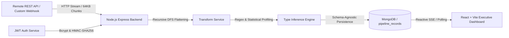

# FlowForge — Real-Time Dynamic API-to-Visualizer ETL Pipeline

FlowForge is an end-to-end, schema-agnostic ETL (Extract, Transform, Load) platform that connects to any remote JSON API endpoint, streams the payload, unwinds complex nested objects and arrays using a recursive depth-first search (DFS) engine, infers runtime column data types, and loads the transformed records into MongoDB while streaming real-time telemetry to an executive dashboard.

---

## Architecture Overview



---

## Key Features

- **Schema-Agnostic Extraction:** Stream and ingest any JSON shape from third-party APIs without manual schema definition.
- **Recursive Depth-First Transform Engine:** Unwinds nested objects, irregular schemas, and polymorphic arrays into tabular format.
- **Runtime Type Inference:** Profile columns dynamically into numeric, temporal, and categorical types with nullity tracking.
- **MongoDB Persistence:** Persists transformed datasets and pipeline execution metadata in `pipeline_records`.
- **JWT & Role-Based Authentication:** Complete sign-in / registration lifecycle with bcrypt password hashing (12 salt rounds) and Bearer token protected routes.
- **Modern Executive Dashboard:** Real-time ingestion telemetry graphs, reactive data tables with customizable pagination, CSV / JSON export, and DAG workflow monitors.

---

## Tech Stack

- **Backend:** Node.js, Express.js, Mongoose, JSONWebToken (JWT), Bcrypt, Axios
- **Database:** MongoDB
- **Frontend:** React 19, Vite, Tailwind CSS, Motion (Framer Motion), Lucide Icons, Canvas-Confetti
- **Testing & Tooling:** Postman, Vitest, Lenis Smooth Scroll

---

## Getting Started

### Prerequisites

- [Node.js](https://nodejs.org/) (v18 or higher recommended)
- [MongoDB](https://www.mongodb.com/try/download/community) installed and running locally on port 27017

---

### Backend Setup

1. Navigate to the backend directory:
   ```bash
   cd etl-backend
   ```

2. Install dependencies:
   ```bash
   npm install
   ```

3. Create your `.env` file from the provided example:
   ```bash
   cp .env.example .env
   ```

4. Start the backend development server:
   ```bash
   npm run dev
   ```
   *The server runs by default on `http://localhost:5000`.*

---

### Frontend Setup

1. In a new terminal, navigate to the frontend directory:
   ```bash
   cd etl-frontend
   ```

2. Install dependencies:
   ```bash
   npm install
   ```

3. Start the Vite development server:
   ```bash
   npm run dev
   ```
   *The frontend dashboard will be available at `http://localhost:3000`.*

---

## API Endpoints

### Authentication (`/api/auth`)
| Method | Endpoint | Description |
| :--- | :--- | :--- |
| `POST` | `/api/auth/register` | Register a new user (`name`, `email`, `password`) |
| `POST` | `/api/auth/login` | Authenticate credentials and receive a signed JWT |

### ETL Pipeline (`/api/etl`) — *Protected (Requires `Authorization: Bearer <token>`)*
| Method | Endpoint | Description |
| :--- | :--- | :--- |
| `POST` | `/api/etl/run` | Execute extraction, DFS transformation, type inference, and persist to MongoDB |
| `GET` | `/api/etl/history` | Retrieve paginated history of past pipeline executions |
| `GET` | `/api/etl/history/:id` | Fetch full transformed dataset for a specific batch run |

---

## License

This project was built as a Capstone Project by Vedant Gupta.
