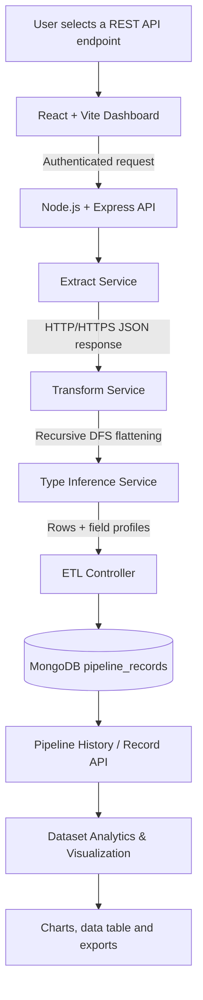

# ForgeFlow — Schema-Agnostic API-to-Analytics ETL Platform

ForgeFlow is a full-stack ETL platform that connects to external JSON REST APIs, transforms nested and irregular JSON payloads into tabular records, infers field types, persists pipeline runs in MongoDB, and presents the resulting datasets through an interactive dashboard.

The project is designed to make API data easier to inspect and work with without requiring users to define a rigid schema before ingestion.

## Project Overview

ForgeFlow follows an Extract → Transform → Infer → Load workflow:

1. **Extract:** Connect to a remote JSON endpoint using HTTP or HTTPS. The backend supports GET and POST requests, custom headers, optional bearer-token authentication, JSON request bodies, and request timeouts.
2. **Transform:** Flatten nested JSON objects with a recursive depth-first traversal. Arrays of objects are unwound into individual rows, while arrays of primitive values are represented as comma-separated values.
3. **Infer:** Inspect the resulting columns and classify them as numeric, temporal, or categorical. Generate field profiles containing sample values, unique counts, null counts, and coverage.
4. **Load:** Persist transformed rows and pipeline metadata as schema-flexible MongoDB documents in the `pipeline_records` collection.
5. **Explore:** Use the dashboard to inspect pipeline history, browse transformed records, review field profiles, visualize stored datasets, and export data.

## Key Features

- **Custom REST API connections:** Configure an endpoint, HTTP method, headers, bearer token, and optional JSON request body.
- **Schema-agnostic JSON transformation:** Recursively flatten nested objects and unwind arrays of objects without requiring a predefined database schema.
- **Runtime type inference:** Classify fields as numeric, temporal, or categorical and calculate basic data-quality profiles.
- **MongoDB persistence:** Store each persisted ETL run with its source URL, method, timestamp, row count, field metadata, transformed data, and execution duration.
- **Pipeline history:** Browse paginated run history and retrieve an individual pipeline record.
- **Dataset analytics and visualization:** Explore stored pipeline datasets and create visualizations from their actual fields rather than relying on fixed field names.
- **Data inspection and export:** Inspect transformed rows and MongoDB documents, and export datasets in CSV or JSON formats.
- **Authentication:** Register and log in with password hashing and JWT-protected ETL routes.
- **Responsive dashboard:** A React dashboard with a dark visual theme, interactive components, and charting powered by Recharts.

## Architecture



### Backend request lifecycle

The Express application loads environment configuration, configures CORS and JSON body parsing, connects to MongoDB through Mongoose, and mounts authentication and ETL routes. The ETL controller orchestrates extraction, transformation, type inference, and optional persistence.

**Implementation note:** The extraction service receives the HTTP response through Node.js stream events and accumulates response chunks before assembling and parsing the complete JSON payload. The current implementation is chunk-based response consumption, not a fully incremental record-by-record ETL pipeline.

## Technology Stack

| Layer | Technologies |
|---|---|
| Frontend | React 19, Vite, Tailwind CSS, Motion, Lucide React |
| Visualization | Recharts |
| Backend | Node.js, Express.js |
| Database / ODM | MongoDB, Mongoose |
| Authentication | JSON Web Token (JWT), bcrypt |
| HTTP / data handling | Node.js `http` and `https`, JSON, Fetch API |
| Development tools | Git, GitHub, Postman, Visual Studio Code |

## Repository Structure

```text
ForgeFlow/
├── etl-backend/
│   ├── server.js
│   └── src/
│       ├── config/          # MongoDB connection
│       ├── controllers/     # Authentication and ETL orchestration
│       ├── middleware/      # JWT authentication and role checks
│       ├── models/          # User and PipelineRecord models
│       ├── routes/          # /api/auth and /api/etl routes
│       ├── services/        # Extraction, transformation, type inference
│       └── utils/           # Centralized error handling
├── etl-frontend/
│   └── src/
│       ├── components/      # Landing page, dashboard and UI modules
│       ├── data/            # Demonstration/preset datasets
│       ├── services/        # ETL client and backend API adapter
│       └── utils/           # Frontend utilities
└── stitch_assets/           # Design assets
```

## API Reference

The backend runs on port `5000` by default. Protected routes require:

```http
Authorization: Bearer <JWT>
```

### Health

| Method | Endpoint | Description |
|---|---|---|
| GET | `/health` | Returns backend health status |

### Authentication — `/api/auth`

| Method | Endpoint | Description |
|---|---|---|
| POST | `/api/auth/register` | Register with name, email, and password |
| POST | `/api/auth/login` | Authenticate and receive a JWT |

### ETL — `/api/etl`

| Method | Endpoint | Description |
|---|---|---|
| POST | `/api/etl/run` | Extract, flatten, infer field types, and optionally persist a dataset |
| GET | `/api/etl/history` | Retrieve paginated pipeline history (without the large data arrays) |
| GET | `/api/etl/history/:id` | Retrieve one saved pipeline record, including transformed data |

#### Example ETL request

```http
POST /api/etl/run
Content-Type: application/json
Authorization: Bearer <JWT>
```

```json
{
  "url": "https://jsonplaceholder.typicode.com/users",
  "method": "GET",
  "persist": true,
  "timeoutMs": 30000
}
```

The request may also include `headers`, `bearerToken`, and a JSON `body` for POST requests. Alternatively, a JSON `rawData` payload can be supplied directly for transformation without fetching a remote endpoint.

## Getting Started

### Prerequisites

- Node.js 20 or later (as specified by the backend package)
- MongoDB running locally or a MongoDB Atlas connection
- npm
- A modern web browser

### 1. Clone the repository

```bash
git clone https://github.com/Vedant169/ForgeFlow.git
cd ForgeFlow
```

### 2. Configure and start the backend

```bash
cd etl-backend
npm install
```

Create a `.env` file using the available example configuration and provide the required values:

```env
PORT=5000
MONGO_URI=mongodb://127.0.0.1:27017/etl_pipeline
JWT_SECRET=replace_with_a_long_random_secret
ALLOWED_ORIGINS=http://localhost:3000,http://localhost:5173
NODE_ENV=development
```

Start the backend:

```bash
npm run dev
```

The API is available at `http://localhost:5000`.

### 3. Start the frontend

Open a second terminal:

```bash
cd etl-frontend
npm install
npm run dev
```

Vite serves the frontend at the URL printed in the terminal (the project is configured for port 3000).

### 4. Run a pipeline

1. Register or log in.
2. Open the dashboard.
3. Connect a public JSON REST endpoint or configure a custom endpoint.
4. Run the ETL pipeline.
5. Review the transformed rows and inferred field profiles.
6. Confirm that the run appears in MongoDB pipeline history.
7. Select a saved dataset to inspect and visualize its fields.

## Data Model

Each persisted pipeline run is stored as a document in `pipeline_records`. The main fields include:

| Field | Description |
|---|---|
| `sourceUrl` | Source API URL |
| `httpMethod` | HTTP method used for extraction |
| `runAt` | Pipeline execution timestamp |
| `rowCount` | Number of flattened rows |
| `metadata` | Field profiles and type summary |
| `data` | Array of transformed row objects |
| `durationMs` | Measured ETL execution duration |

The schema uses flexible storage for metadata and transformed rows so that different API response shapes can be persisted without creating a new Mongoose schema for every source.

## Transformation and Type Inference

### Recursive JSON flattening

Nested object keys are joined with underscores to form flat column names. For example:

```json
{
  "user": {
    "name": "Asha",
    "age": 21
  },
  "orders": [
    { "product": "Laptop", "price": 65000 },
    { "product": "Mouse", "price": 800 }
  ]
}
```

The nested object fields become names such as `user_name` and `user_age`. The array of order objects is unwound into separate rows, with parent context retained where applicable.

### Runtime field profiles

The inference service evaluates non-null values and assigns one of three types:

- **Numeric:** values consistently parse as finite numbers.
- **Temporal:** values match supported date/time formats.
- **Categorical:** text, booleans, mixed values, and values that do not satisfy the numeric or temporal checks.

Field profiles include total count, null count, unique count, coverage, and up to ten sample values.

## Security and Configuration Notes

- Passwords are hashed with bcrypt before storage.
- ETL history and execution routes use JWT authentication middleware.
- Keep `MONGO_URI` and `JWT_SECRET` in environment variables; never commit real credentials.
- Use HTTPS for deployed services and configure production CORS origins explicitly.
- Because users can provide external URLs, a production deployment should add strict outbound URL validation and private-network/metadata-address protections to mitigate server-side request forgery (SSRF).
- Apply sensible response-size limits and request timeouts when connecting to untrusted APIs.

## Current Scope and Limitations

- The extraction service assembles the complete response body before JSON parsing; very large payloads can still consume significant memory.
- Nested independent arrays can expand into multiple combinations of rows during recursive flattening.
- The current backend package does not define an automated test suite; the package test script is a placeholder.
- Client-side fallback transformation exists for selected demo/preset flows. Data processed only in the browser is not equivalent to a MongoDB-persisted run; use the backend execution path and verify a saved record when persistence is required.
- Type inference is deterministic and heuristic. It is useful for exploration, but it is not a substitute for a formal source schema or domain validation.

## Future Enhancements

- Incremental parsing and bounded-memory ingestion for large JSON payloads.
- Stronger SSRF protections, endpoint allowlists, and per-source credential handling.
- Automated unit, integration, and end-to-end tests.
- Data-quality rules, schema drift detection, and richer profiling.
- Saved chart configurations and shareable analytics views.
- Background jobs and progress reporting for long-running pipelines.
- Role-based access controls and per-user ownership/isolation of pipeline records.

## License and Project Information

Developed as a B.Tech Computer Science & Engineering capstone project by **Vedant Gupta**.

- **Repository:** https://github.com/Vedant169/ForgeFlow
- **Primary branch:** `main`

